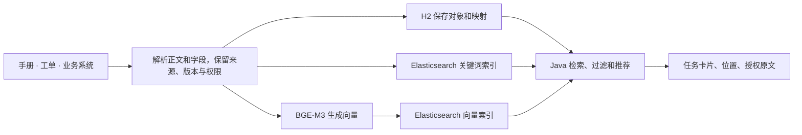

# 多源搜索推荐引擎

把文档目录和业务表接入同一个搜索推荐服务。正在给知识库、内部工具或论坛增加检索能力的开发者，可以通过 HTTP API 搜资料、按当前任务推荐内容，让用户从结果直接打开自己有权阅读的原文。

[运行 Windows 演示](docs/setup.md) · [接入自己的资料](docs/cookbook/01-documents.md) · [全部功能与 API 导览](docs/features.md) · [Cookbook 实操手册](docs/cookbook/README.md)

## 系统架构

业务系统通过 HTTP API 调用 Java 引擎。每套部署使用独立的对象库和搜索索引，文本向量在本地生成。

| 组件 | 职责 |
| --- | --- |
| **Java 17 引擎** | 接收内容更新和查询请求。混合搜索用 RRF 融合关键词与向量召回的名次；推荐按参考对象、当前任务或用户偏好对候选资料排序。 |
| **H2 嵌入式数据库** | 保存内容对象、版本、权限和来源位置。读取原文时，Java 引擎据此校验访问权限并定位当前版本。 |
| **Elasticsearch** | 维护全文索引和向量索引，向引擎返回 BM25 关键词检索与向量近邻检索的候选结果。 |
| **BGE-M3 模型服务（Python）** | 将资料片段和查询文本编码为 1024 维向量，供索引构建和语义检索使用。 |

## 数据怎样变成推荐

- **查工单时保留业务字段。** 搜“更换滤芯”可用关键词和语义召回；查编号 `00017` 则用字符串精确条件。内容与结构化约束可以在同一查询中使用。
- **推荐卡片带回操作原文。** 引擎先确定资料顺序，再从当前有权访问的文档版本中为任务选择展示片段。一次小样本对照使用两套公开技术手册，在 9 个有答案的任务上，前五张卡可直接看见的必要操作由 9/18 增至 11/18，资料排序相同。该项由助手按任务核对，2 个来源，1 项任务退化；衡量的是卡片可见内容。
- **推荐跟随身份和上下文。** 当前任务、显式偏好和经许可的行为可以进入排序；打开原文、分页和统计仍核对访问权限。清除当前任务后，可继续基于偏好或相关资料浏览。[机制与适用边界](docs/mechanism.md)

## 可以用在哪里

| 场景 | 提供给用户的功能 | 开发者入口 |
|---|---|---|
| 文档知识库 | 全文或语义检索，查看原文片段、页码或段落，跟踪源文件修改 | [文档导入与更新](docs/cookbook/01-documents.md) |
| 业务台账 | 将稳定编号、日期、金额等映射为字段，与说明文档一起使用 | [接入第二份数据源](docs/cookbook/02-tables.md) |
| 运维、客服或培训工作台 | 填写当前任务，找手册、相关记录，反馈推荐或切换身份 | [任务推荐、权限和反馈](docs/cookbook/03-recommendations.md) |
| 论坛后端 | 同步帖子和栏目权限，展示相关帖子，按授权上报收藏等行为 | [论坛接入与可运行示例](docs/features.md#论坛怎样接入) |

## 运行与集成

首发环境为 Windows x64。核心服务使用 Java 17 和 H2，搜索使用 Elasticsearch 8.19，语义检索使用本地 Python 3.11 与固定版 BGE-M3。首次安装准备依赖与模型后，查询可在内网执行。模型文件和运行时独立获取。部署说明包含源码构建、使用演示包、端口和私有身份设置。[安装与启动](docs/setup.md)

当前采用**单部署内多源集中索引**。可导入 TXT、Markdown、HTML、文本型 PDF、DOCX，以及明确配置字段的 CSV 和规则 XLSX。真实 MySQL 连接依赖用户配置的只读视图、驱动和 TLS；本版以适配器与模拟验证覆盖该路径。跨单位独立索引查询、扫描件 OCR 和多媒体转写属于后续能力。[功能导览](docs/features.md) · [HTTP API 合约](contracts/v1.6/openapi.json)

## English

**Multi-source Search Recommender** is a self-hosted Java service for searching documents and structured records, recommending material for a current task, and opening the matching source under the reader’s permissions. The Windows demo includes sample maintenance manuals and work orders. It indexes multiple sources in one deployment and runs embeddings locally. [Windows setup](docs/setup.md) · [API contract](contracts/v1.6/openapi.json)

本项目自有代码采用 [Apache License 2.0](LICENSE)，第三方组件分别遵循其许可。欢迎提交可复现问题和改进建议。[贡献说明](CONTRIBUTING.md) · [安全问题反馈](SECURITY.md)

[0.2.0 发行与验证记录](RELEASE.md) · [第三方组件](third-party/components.json)
